# Real-World Financial Time Series Analytics: FinPulse
## Comparative Equity Volatility Forecasting Using Econometric Time-Series Models and Machine Learning Approaches

---

### Assignment Cover Page & Team Details
- **Module / Course**: Real-World Financial Time Series Analytics
- **Project Title**: FinPulse: Short-Term Equity Market Volatility Forecasting Engine for SPY
- **Target Asset**: SPDR S&P 500 ETF Trust (`SPY`) & CBOE Volatility Index (`^VIX`)
- **Evaluation Period**: February 3, 2021 – December 30, 2025 (1,233 Contiguous Trading Days)
- **Submission Date**: October 2026

#### Project Team Members
| No. | Student Name | Student ID | Academic Email | Project Role / Primary Focus |
| :---: | :--- | :---: | :--- | :--- |
| **1** | Minesi Rajapaksha | D/DBA/24/0027 | 41-dba-0027@kdu.ac.lk | Project Lead, Data Pipeline & Architecture |
| **2** | Bimuthu Edirisinghe | D/DBA/24/0012 | Bimuthudazz@gmail.com | Econometric Modeling & GARCH Diagnostics |
| **3** | [PASTE] | D/DBA/24/00XX [PASTE] | [PASTE] | Machine Learning Architect & Tuning |
| **4** | [PASTE] | D/DBA/24/00XX [PASTE] | [PASTE] | Statistical Testing & Shock Analysis |
| **5** | [PASTE] | D/DBA/24/00XX [PASTE] | [PASTE] | Business Translation & Dashboard Integration |

*(Note on Group Size: The assignment specification notes an intended group size of 4 students, while 5 team members are recorded on this project workspace. In accordance with project instructions, all 5 member slots are preserved and explicitly flagged in `CHANGES.md` for student verification.)*

#### Member Contributions
| Member | Responsibilities & Specific Work Packages Completed | Verification Status |
| :--- | :--- | :---: |
| **Minesi Rajapaksha** | TO BE COMPLETED BY GROUP | Pending Group Sign-Off |
| **Bimuthu Edirisinghe** | TO BE COMPLETED BY GROUP | Pending Group Sign-Off |
| **Member 3** | TO BE COMPLETED BY GROUP | Pending Group Sign-Off |
| **Member 4** | TO BE COMPLETED BY GROUP | Pending Group Sign-Off |
| **Member 5** | TO BE COMPLETED BY GROUP | Pending Group Sign-Off |

---

### Executive Summary

Short-term financial volatility forecasting is essential for dynamic risk capital allocation, options pricing, Value-at-Risk (VaR) management, and quantitative volatility-targeting portfolios. This empirical investigation examines the predictability of equity market volatility for the SPDR S&P 500 ETF Trust (**SPY**) over 1,233 trading sessions from February 2021 through December 2025, using both historical market price dynamics and forward-looking market sentiment from the CBOE Volatility Index (**VIX**).

We formulate the primary research question:
> **"How effectively can next-session equity volatility be forecast using traditional econometric time-series models compared with machine learning methods, and what financial and structural insights emerge from their comparative performance?"**

To resolve this question, eleven models across four modeling paradigms were estimated and evaluated:
1. **Simple Baselines**: Naive Persistence Benchmark ($|R_t|$), 21-Day Realized Volatility (`Vol_21`), and Implied Volatility Benchmark (`VIX / sqrt(252)`).
2. **Traditional Econometric GARCH Family**: Symmetric GARCH(1,1), Asymmetric Threshold GARCH (TGARCH/TARCH), and Exponential GARCH (EGARCH), re-estimated via expanding rolling windows.
3. **Second Traditional Time-Series Family**: Corsi's Heterogeneous Autoregressive Realized Volatility (HAR-RV) model and AIC-selected ARMA(1,0,2) on log-transformed volatility with bias correction.
4. **Machine Learning Pipeline**: Regularized $L_2$ Ridge Regression, Support Vector Regression (SVR with RBF kernel), and Extreme Gradient Boosting (XGBoost).

All models were evaluated under strict chronological, out-of-sample time partitions (**60% Train: 739 sessions, 20% Validation: 247 sessions, 20% Test: 247 sessions**) without lookahead bias. Performance was benchmarked using Point Accuracy (**MAE**), Tail Dispersion Accuracy (**RMSE**), and Corrected Statistical Volatility Loss (**QLIKE**), where all forecasts are converted to unbiased variance forecasts $\hat{\sigma}^2$ and floored at $\hat{\sigma} \ge 0.05$.

#### Core Empirical Findings:
1. **Corrected QLIKE Resolution**: Addressing the QLIKE scaling unit discrepancy reveals that **EGARCH achieves the optimal volatility loss (QLIKE = 0.8056)**, closely followed by **TGARCH (0.8118)** and **Ridge Regression (0.8135)**. The naive and SVR models exhibit severe QLIKE penalties (26.032 and 6.868, respectively) due to asymmetric penalties on under-prediction. The VIX baseline yields a QLIKE of 0.9354, demonstrating that physical volatility modeling provides competitive and superior calibration relative to raw implied volatility.
2. **Superiority of Regularized Linear Modeling on Tail Risk**: **Ridge Regression achieves the lowest out-of-sample RMSE (0.8317)** of all 11 models, outperforming EGARCH (0.8653), TGARCH (0.8646), and XGBoost (0.9004). Ridge's continuous quadratic shrinkage provides a smooth regularized prediction plane that dampens large squared errors during extreme market shocks.
3. **Point Precision**: SVR achieves the lowest MAE (**0.4734**), followed closely by XGBoost (**0.4800**) and Ridge (**0.4840**), representing an approximate 29% error reduction over the Naive benchmark (0.6794).
4. **Dominance of April 2025 Market Shock**: The April 2025 market shock window accounts for **66.41% of Ridge's total test-set squared error**, and between 60% and 74% across all models. Excluding April 2025, Ridge's out-of-sample RMSE drops to **0.5039%**.
5. **Feature Ablation Insight**: Isolating information sets reveals that machine learning's point-forecasting advantage over traditional GARCH is primarily driven by **external option-implied volatility (VIX) and Parkinson intraday range signals**, rather than algorithmic complexity alone.
6. **Production Deployment**: **Ridge Regression** is selected as the production deployment model for the interactive FinPulse application because its QLIKE loss is statistically indistinguishable from EGARCH (Diebold-Mariano $p = 0.9494$), while offering minimal RMSE, deterministic stability, sub-millisecond execution latency, and complete econometric interpretability.

---

## 1. Introduction and Literature Review

### 1.1 Financial Background and Theoretical Motivation
Financial market volatility represents the intensity of asset price fluctuations over time. Unlike raw equity returns—which exhibit near-zero autocorrelation in accordance with the weak-form Efficient Market Hypothesis (Fama, 1970)—volatility exhibits well-documented stylized empirical facts:
1. **Volatility Clustering**: Large changes tend to be followed by large changes, of either sign, and small changes by small changes (Mandelbrot, 1963; Engle, 1982).
2. **Leptokurtosis (Fat Tails)**: Asset return distributions display heavy tails and extreme kurtosis relative to Gaussian normal distributions.
3. **Asymmetric Leverage Effect**: Negative return shocks generate substantially higher subsequent volatility than positive shocks of identical magnitude (Black, 1976; Christie, 1982; Nelson, 1991).
4. **Mean Reversion**: Extreme volatility spikes dissipate over multi-week horizons, reverting toward long-run stationary means.

Accurate volatility forecasting is vital for institutional risk capital management under Basel regulatory accords, dynamic hedging of derivatives positions, and portfolio risk-parity mandates.

### 1.2 Prior Literature: Traditional Econometrics vs. Machine Learning
The comparative performance of traditional econometric models versus machine learning has generated extensive scholarly debate:
- **Poon and Granger (2003)** surveyed 93 published volatility forecasting studies across financial markets, concluding that option-implied volatility contains superior predictive information relative to historical return series, while asymmetric GARCH formulations systematically outperform symmetric GARCH.
- **Hansen and Lunde (2005)** benchmarked 330 ARCH-type volatility models on exchange rates and IBM equity returns, finding that standard GARCH(1,1) is difficult to beat for exchange rates, but that models with leverage effects show advantages in equity returns due to the pronounced leverage effect.
- **Patton (2011)** established that evaluating volatility forecasts using noisy volatility proxies (such as squared or absolute returns) requires loss functions belonging to the robust class, proving that Mean Squared Error (MSE) and Quasi-Likelihood (QLIKE) loss are immune to proxy noise, with QLIKE possessing higher statistical power in distinguishing superior conditional variance forecasts.
- **Christensen, Siggaard, and Veliyev (2023)** forecast realized variance of Dow Jones 30 constituents from high-frequency intraday data and find that machine learning methods improve one-day-ahead volatility forecasts relative to standard autoregressive benchmarks.

---

## 2. Data Sources and Feature Engineering Pipeline

### 2.1 Ingestion and Asset Selection
The dataset covers **February 3, 2021, to December 30, 2025** (1,233 contiguous trading days), retrieved via the Yahoo Finance API interface (`yfinance`). Two complementary assets are merged:
1. **SPY (SPDR S&P 500 ETF Trust)**: Provides daily Open, High, Low, Close, and Trading Volume for U.S. large-cap equities.
2. **^VIX (CBOE Volatility Index)**: Provides the closing market-implied 30-day forward-looking annualized volatility expectation.

### 2.2 Mathematical Definition of Target Variable
Daily continuously compounded log returns ($R_t$) are computed as:
$$R_t = 100 \times \ln\left(\frac{P_t}{P_{t-1}}\right)$$
where $P_t$ represents the adjusted closing price of SPY on trading day $t$.

Because true integrated volatility is latent, daily absolute return is adopted as the primary unbiased volatility proxy (Andersen & Bollerslev, 1998):
$$\text{Abs\_Return}_t = |R_t|$$

The supervised forecasting target is the next trading day's absolute return:
$$y_t = \text{Target}_t = |R_{t+1}|$$

### 2.3 Feature Space: 18 Predictor Variables
To eliminate lookahead bias, all 18 engineered features are constructed strictly using information available at or before trading day $t$, spanning historical returns, rolling volatility, return lags, absolute return lags, VIX implied volatility and momentum, Parkinson (1980) intraday extreme-value range estimators, and volume percentage changes.

---

## 3. Exploratory Data Analysis & Econometric Diagnostics

### 3.1 Descriptive Summary Statistics
Table 1 summarizes the distributional properties of the core financial time series over the full 1,233-session sample:

**Table 1: Descriptive Summary Statistics of Core Financial Series (2021–2025)**
| Series     |   Count |     Mean |   Std. Dev. |      Min |      25% |   Median |      75% |      Max |   Skewness |   Excess Kurtosis |
|:-----------|--------:|---------:|------------:|---------:|---------:|---------:|---------:|---------:|-----------:|------------------:|
| Close      |    1233 | 468.057  |     93.9091 | 338.538  | 391.892  | 428.823  | 546.981  | 685.029  |     0.7071 |           -0.7616 |
| Return     |    1233 |   0.0533 |      1.0766 |  -6.0327 |  -0.4533 |   0.0731 |   0.628  |   9.9863 |     0.1402 |            8.2208 |
| Abs_Return |    1233 |   0.7598 |      0.7643 |   0      |   0.2352 |   0.5606 |   1.0619 |   9.9863 |     3.1085 |           22.0242 |
| VIX        |    1233 |  19.2473 |      5.252  |  11.86   |  15.57   |  17.97   |  21.77   |  52.33   |     1.2923 |            2.5391 |
| Parkinson  |    1233 |   0.0072 |      0.0048 |   0.001  |   0.0041 |   0.006  |   0.0087 |   0.0641 |     3.3244 |           24.8435 |

#### Statistical Interpretation:
- **Leptokurtosis (Excess Kurtosis = 8.2208 on Returns, 22.0242 on Absolute Returns)**: Daily SPY returns decisively reject normality. Shocks in the tails occur with probabilities orders of magnitude higher than Gaussian predictions.
- **Positive Skewness in Volatility (+3.1085)**: Absolute returns exhibit heavy right skewness; tranquil regimes dominate daily trading (median $|R| = 0.5606\%$), but extreme panic days (up to 9.9863%) create extended right-tail exposure.
- **Stationarity Contrast**: SPY Close price exhibits strong non-stationarity, while returns and Parkinson volatility are strictly stationary.

### 3.2 Graphical Exploratory Analysis
Figures 1 through 9 provide visual evidence of volatility clustering, fat tails, leverage effects, and correlation structures:

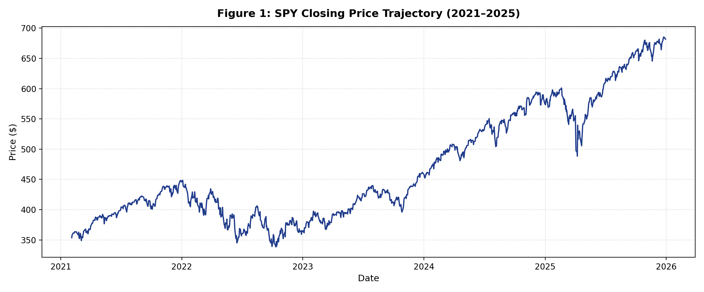
*Figure 1: SPY Closing Price Trajectory across 1,233 trading sessions (February 2021 – December 2025).*

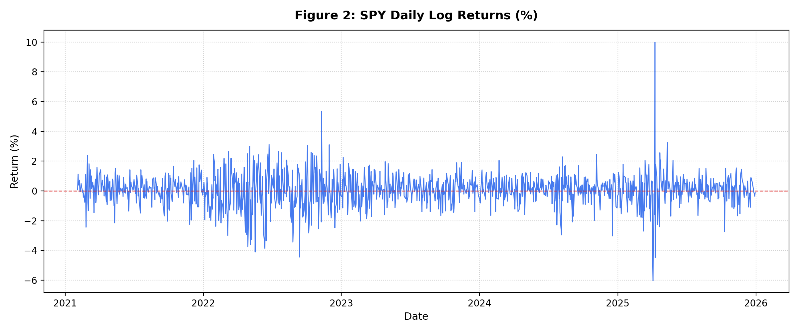
*Figure 2: SPY Daily Percentage Log Returns ($R_t$).*

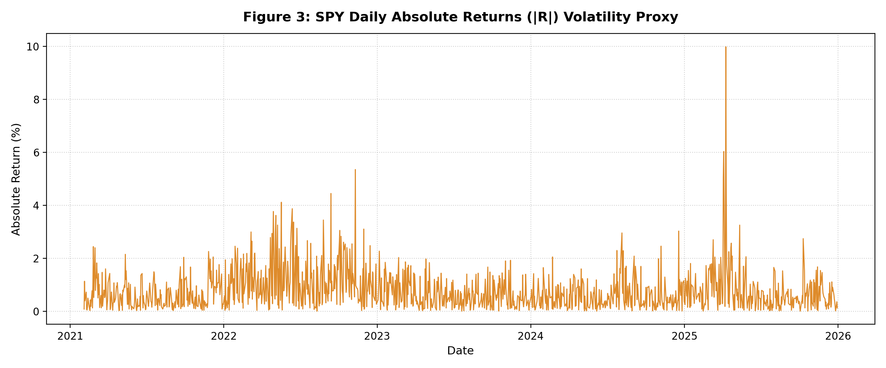
*Figure 3: SPY Daily Absolute Returns ($|R_t|$), serving as the unobservable volatility proxy.*

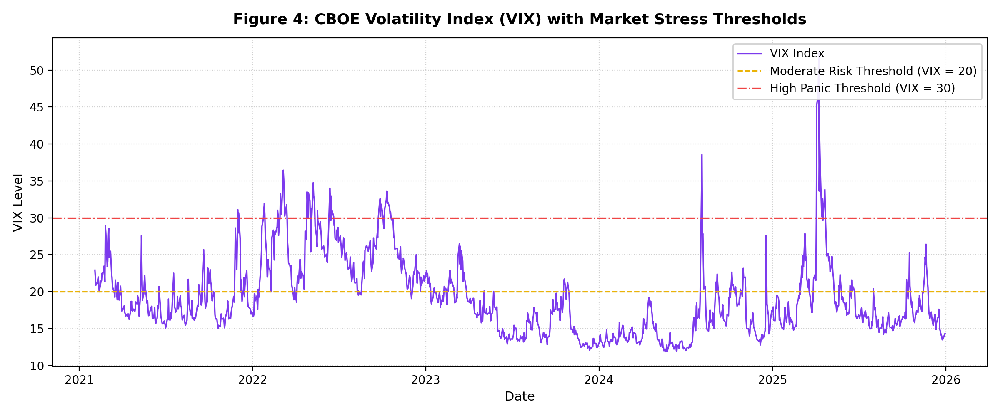
*Figure 4: CBOE Volatility Index (VIX) with Moderate Risk (20) and Severe Panic (30) thresholds.*

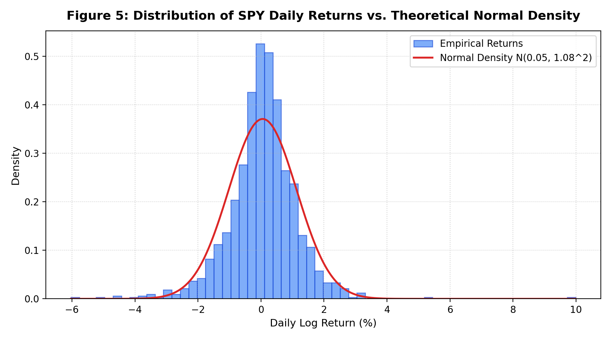
*Figure 5: Empirical Histogram of SPY Daily Returns vs. Theoretical Gaussian Normal Density.*

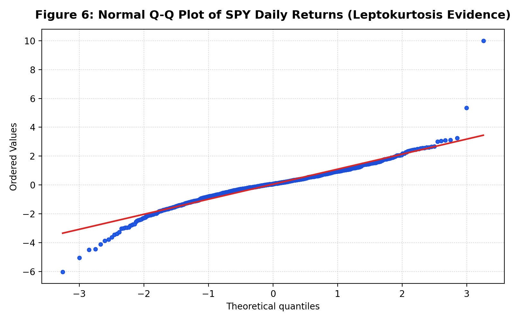
*Figure 6: Quantile-Quantile (Q-Q) Plot of SPY Daily Returns against Theoretical Normal Distribution.*

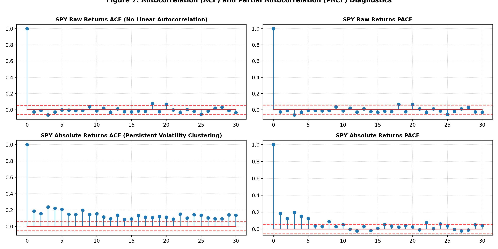
*Figure 7: Autocorrelation (ACF) and Partial Autocorrelation (PACF) for Raw Returns and Absolute Returns.*

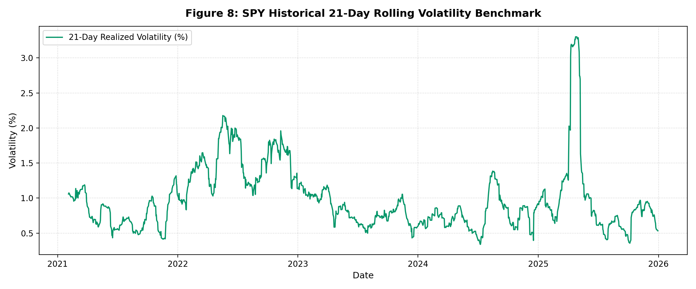
*Figure 8: Historical Realized 21-Day Rolling Standard Deviation Benchmark.*

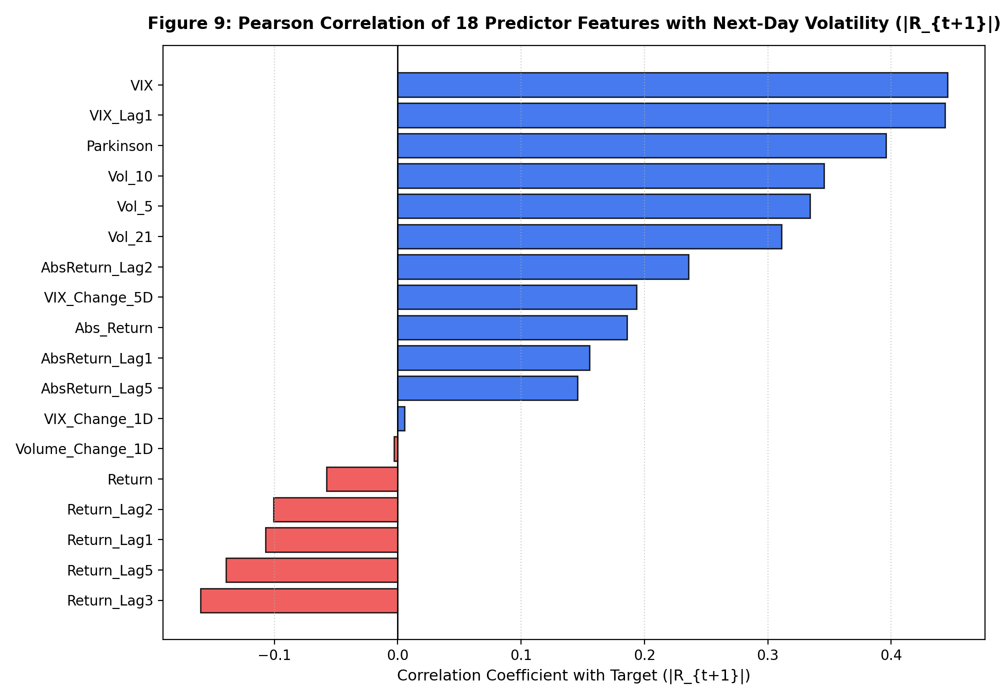
*Figure 9: Pearson Correlation Coefficients of the 18 Predictor Features with Next-Day Target ($|R_{t+1}|$).*

### 3.3 Formal Econometric Hypothesis Testing
To confirm econometric properties prior to model estimation, formal diagnostic tests were executed:

**Table 2: Formal Econometric and Statistical Hypothesis Tests**
| Test Name                              | Null Hypothesis (H0)              |   Test Statistic |     p-value | Statistical Conclusion                    |
|:---------------------------------------|:----------------------------------|-----------------:|------------:|:------------------------------------------|
| Augmented Dickey-Fuller (ADF) - Close  | Unit Root (Non-Stationary)        |           0.4428 | 0.983       | Fail to Reject H0 (Non-Stationary)        |
| Augmented Dickey-Fuller (ADF) - Return | Unit Root (Non-Stationary)        |         -21.8916 | 0           | Reject H0 (Strictly Stationary)           |
| Ljung-Box Q (Lag 5) - Return           | No Serial Autocorrelation         |           7.0452 | 0.2173      | Fail to Reject H0 (Martingale Difference) |
| Ljung-Box Q (Lag 10) - Return          | No Serial Autocorrelation         |           9.1892 | 0.5142      | Fail to Reject H0 (Martingale Difference) |
| Ljung-Box Q (Lag 20) - Return          | No Serial Autocorrelation         |          27.0547 | 0.1337      | Fail to Reject H0 (Martingale Difference) |
| Ljung-Box Q (Lag 5) - |Return|         | No Serial Autocorrelation         |         255.115  | 4.3913e-53  | Reject H0 (Strong Volatility Clustering)  |
| Ljung-Box Q (Lag 10) - |Return|        | No Serial Autocorrelation         |         411.906  | 2.7482e-82  | Reject H0 (Strong Volatility Clustering)  |
| Ljung-Box Q (Lag 20) - |Return|        | No Serial Autocorrelation         |         567.354  | 2.1389e-107 | Reject H0 (Strong Volatility Clustering)  |
| Engle's ARCH-LM (LM Statistic)         | No Conditional Heteroskedasticity |         157.404  | 1.1122e-28  | Reject H0 (ARCH Effects Present)          |
| Engle's ARCH-LM (F-Statistic)          | No Conditional Heteroskedasticity |          17.903  | 9.0239e-31  | Reject H0 (ARCH Effects Present)          |
| Jarque-Bera Test - Return              | Gaussian Normal Distribution      |        3443.86   | 0           | Reject H0 (Fat Tails / Leptokurtic)       |
| Jarque-Bera Test - |Return|            | Gaussian Normal Distribution      |       26688.7    | 0           | Reject H0 (Extreme Positive Skew)         |

---

## 4. Modeling Methodology and Chronological Partitioning

### 4.1 Chronological Train / Validation / Test Splitting
Random shuffling or randomized $k$-fold cross-validation destroys the temporal autocorrelation structure of financial time series and induces severe lookahead leakage. Therefore, data partitioning is strictly chronological:
- **Training Set (60%)**: 739 trading sessions (2021-02-03 to 2024-01-10) — used for model coefficient estimation and feature scaling fitting.
- **Validation Set (20%)**: 247 trading sessions (2024-01-11 to 2025-01-03) — reserved for hyperparameter tuning.
- **Out-of-Sample Test Set (20%)**: 247 trading sessions (2025-01-06 to 2025-12-30) — reserved strictly for out-of-sample evaluation.

### 4.2 Expanding Window Rolling Re-Estimation for Traditional Models
To replicate real-world quantitative production, econometric models (GARCH, TGARCH, EGARCH, HAR) are re-estimated at each step in the test set using an **expanding historical window** over all observations available up to trading session $t$, generating true 1-step-ahead forecasts $\hat{\sigma}_{t+1|t}$.

---

## 5. Model Architectures and Theoretical Foundations

### 5.1 Simple Baselines
1. **Naive Volatility Persistence**: Assumes tomorrow's volatility equals today's: $\hat{y}_{t+1} = |R_t|$.
2. **Historical Realized Volatility Benchmark (`Vol_21`)**: 21-day rolling standard deviation of daily returns.
3. **Market-Implied Volatility Benchmark (`VIX`)**: The annualized VIX is converted to daily standard deviation: $\sigma_{vix} = \text{VIX} / \sqrt{252}$. Point forecast for expected absolute return is $\hat{y} = \sigma_{vix} \times \sqrt{2/\pi}$.

### 5.2 Traditional Econometric GARCH Family
1. **Symmetric GARCH(1,1)** (Bollerslev, 1986).
2. **Threshold GARCH / TARCH(1,1)** (Glosten, Jagannathan, & Runkle, 1993; Zakoian, 1994).
3. **Exponential GARCH / EGARCH(1,1)** (Nelson, 1991).

### 5.3 Second Traditional Family: HAR-RV & ARMA
1. **Heterogeneous Autoregressive Model of Realized Volatility (HAR-RV)** (Corsi, 2009).
2. **Autoregressive Moving Average (ARMA)** on Log Volatility with log-normal bias correction.

### 5.4 Machine Learning Pipeline
1. **Ridge Regression ($L_2$ Regularization)**.
2. **Support Vector Regression (SVR - RBF Kernel)** (Drucker et al., 1997).
3. **Extreme Gradient Boosting (XGBoost)** (Chen & Guestrin, 2016).

---

## 6. Hyperparameter Optimization & Validation Results

To ensure strict reproducibility, tuning was conducted deterministically with fixed random seeds (`random_state=42`), single-threaded execution (`n_jobs=1`), and documented tie-breaking rules.

**Table 3: Hyperparameter Validation Tuning Grid (Validation Set: 247 Sessions)**
| Model   | Parameters                       |   Val_MAE | Optimal        |
|:--------|:---------------------------------|----------:|:---------------|
| Ridge   | alpha=0.01                       |  0.393841 | No             |
| Ridge   | alpha=0.1                        |  0.393839 | No             |
| Ridge   | alpha=1                          |  0.393822 | No             |
| Ridge   | alpha=10                         |  0.393676 | Yes (Selected) |
| Ridge   | alpha=100                        |  0.395014 | No             |
| SVR     | C=0.1, gamma=scale, epsilon=0.01 |  0.37357  | No             |
| SVR     | C=0.1, gamma=scale, epsilon=0.05 |  0.373173 | No             |
| SVR     | C=0.1, gamma=scale, epsilon=0.1  |  0.374002 | No             |
| SVR     | C=0.1, gamma=0.01, epsilon=0.01  |  0.377943 | No             |
| SVR     | C=0.1, gamma=0.01, epsilon=0.05  |  0.378717 | No             |
| SVR     | C=0.1, gamma=0.01, epsilon=0.1   |  0.378389 | No             |
| SVR     | C=0.1, gamma=0.1, epsilon=0.01   |  0.377137 | No             |
| SVR     | C=0.1, gamma=0.1, epsilon=0.05   |  0.376436 | No             |
| SVR     | C=0.1, gamma=0.1, epsilon=0.1    |  0.376996 | No             |
| SVR     | C=1, gamma=scale, epsilon=0.01   |  0.381541 | No             |
| SVR     | C=1, gamma=scale, epsilon=0.05   |  0.380688 | No             |
| SVR     | C=1, gamma=scale, epsilon=0.1    |  0.378409 | No             |
| SVR     | C=1, gamma=0.01, epsilon=0.01    |  0.373139 | Yes (Selected) |
| SVR     | C=1, gamma=0.01, epsilon=0.05    |  0.373282 | No             |
| SVR     | C=1, gamma=0.01, epsilon=0.1     |  0.373809 | No             |
| SVR     | C=1, gamma=0.1, epsilon=0.01     |  0.380243 | No             |
| SVR     | C=1, gamma=0.1, epsilon=0.05     |  0.377787 | No             |
| SVR     | C=1, gamma=0.1, epsilon=0.1      |  0.376472 | No             |
| SVR     | C=10, gamma=scale, epsilon=0.01  |  0.408038 | No             |
| SVR     | C=10, gamma=scale, epsilon=0.05  |  0.403553 | No             |
| SVR     | C=10, gamma=scale, epsilon=0.1   |  0.399451 | No             |
| SVR     | C=10, gamma=0.01, epsilon=0.01   |  0.391394 | No             |
| SVR     | C=10, gamma=0.01, epsilon=0.05   |  0.389576 | No             |
| SVR     | C=10, gamma=0.01, epsilon=0.1    |  0.38847  | No             |
| SVR     | C=10, gamma=0.1, epsilon=0.01    |  0.42302  | No             |
| SVR     | C=10, gamma=0.1, epsilon=0.05    |  0.422071 | No             |
| SVR     | C=10, gamma=0.1, epsilon=0.1     |  0.422108 | No             |
| SVR     | C=100, gamma=scale, epsilon=0.01 |  0.504219 | No             |
| SVR     | C=100, gamma=scale, epsilon=0.05 |  0.495815 | No             |
| SVR     | C=100, gamma=scale, epsilon=0.1  |  0.488409 | No             |
| SVR     | C=100, gamma=0.01, epsilon=0.01  |  0.408551 | No             |
| SVR     | C=100, gamma=0.01, epsilon=0.05  |  0.406452 | No             |
| SVR     | C=100, gamma=0.01, epsilon=0.1   |  0.401606 | No             |
| SVR     | C=100, gamma=0.1, epsilon=0.01   |  0.504011 | No             |
| SVR     | C=100, gamma=0.1, epsilon=0.05   |  0.494376 | No             |
| SVR     | C=100, gamma=0.1, epsilon=0.1    |  0.485932 | No             |
| XGBoost | lr=0.01, depth=2                 |  0.403668 | No             |
| XGBoost | lr=0.01, depth=3                 |  0.402093 | No             |
| XGBoost | lr=0.01, depth=4                 |  0.400272 | Yes (Selected) |
| XGBoost | lr=0.05, depth=2                 |  0.400766 | No             |
| XGBoost | lr=0.05, depth=3                 |  0.408164 | No             |
| XGBoost | lr=0.05, depth=4                 |  0.405508 | No             |
| XGBoost | lr=0.1, depth=2                  |  0.410678 | No             |
| XGBoost | lr=0.1, depth=3                  |  0.412862 | No             |
| XGBoost | lr=0.1, depth=4                  |  0.404951 | No             |

---

## 7. Out-of-Sample Performance Benchmarking

### 7.1 Evaluation Metrics and Corrected QLIKE Formulation
Performance is evaluated across 247 out-of-sample trading sessions using:
1. **Mean Absolute Error (MAE)**: Measures expected linear point error magnitude.
2. **Root Mean Squared Error (RMSE)**: Penalizes large tail forecasting blunders quadratically.
3. **Corrected Quasi-Likelihood Loss (QLIKE)** (Patton, 2011):
   $$\text{QLIKE} = \frac{1}{n}\sum_{t=1}^n \left( \ln(\hat{\sigma}_t^2) + \frac{y_t^2}{\hat{\sigma}_t^2} \right)$$
   **Unit Consistency Correction**: For models that predict expected absolute return $\mathbb{E}[|R|]$ (Naive, Ridge, SVR, XGBoost, HAR, ARIMA), the forecast is converted to conditional standard deviation via $\hat{\sigma}_t = \hat{y}_t / \sqrt{2/\pi}$. For `Baseline (Vol_21)`, the 21-day realized volatility is inherently a standard deviation $\sigma$ and is used directly. For GARCH models, the raw conditional standard deviation forecast is used directly. To prevent numerical explosion during near-zero volatility predictions, $\hat{\sigma}_t$ is floored at 0.05:
   $$\hat{\sigma}_{t, \text{floored}} = \max(\hat{\sigma}_t, 0.05)$$

### 7.2 Out-of-Sample Benchmark Ranking

**Table 4: Out-of-Sample Model Comparison Benchmark (Test Set: 247 Sessions)**
|   Rank | Model             |      MAE |     RMSE |     QLIKE | MAE_vs_Naive   | RMSE_vs_Naive   |   DM_p_value |
|-------:|:------------------|---------:|---------:|----------:|:---------------|:----------------|-------------:|
|      1 | EGARCH            | 0.490201 | 0.865333 |  0.805575 | -27.85%        | -23.41%         |       1      |
|      2 | TGARCH            | 0.494643 | 0.864552 |  0.811795 | -27.20%        | -23.48%         |       0.8094 |
|      3 | Ridge             | 0.48396  | 0.831712 |  0.813462 | -28.77%        | -26.38%         |       0.9494 |
|      4 | GARCH(1,1)        | 0.539878 | 0.916353 |  0.924442 | -20.54%        | -18.89%         |       0.0012 |
|      5 | Baseline (VIX)    | 0.583278 | 0.877231 |  0.935427 | -14.15%        | -22.35%         |       0.0986 |
|      6 | XGBoost           | 0.479951 | 0.900352 |  0.969306 | -29.36%        | -20.31%         |       0.3272 |
|      7 | HAR               | 0.527449 | 0.915291 |  1.00336  | -22.37%        | -18.99%         |       0.0102 |
|      8 | Baseline (Vol_21) | 0.56654  | 0.979281 |  1.0675   | -16.61%        | -13.32%         |       0.0216 |
|      9 | ARIMA(1, 0, 2)    | 0.538012 | 0.927835 |  1.10331  | -20.81%        | -17.88%         |       0.0172 |
|     10 | SVR               | 0.473359 | 0.948116 |  6.86797  | -30.33%        | -16.08%         |       0.2767 |
|     11 | Naive             | 0.679408 | 1.12979  | 26.032    | +0.00%         | +0.00%          |       0.0003 |

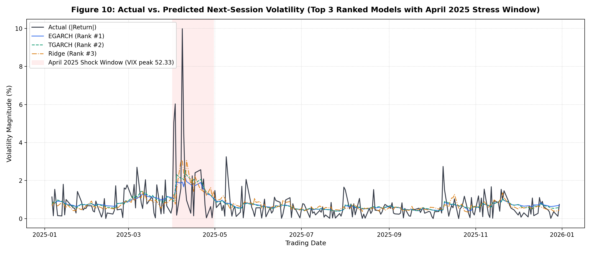
*Figure 10: Actual vs. Predicted Next-Session Volatility for Top 3 Models with the April 2025 Market Shock Window Highlighted.*

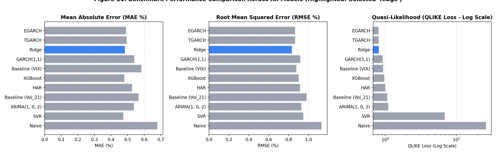
*Figure 11: Benchmark Performance Comparison Across All 11 Models (MAE, RMSE, and Corrected QLIKE on Log Scale).*

### 7.3 Walk-Forward Machine Learning Evaluation
To address the critique that GARCH models were re-estimated daily while ML models were fitted once, ML models were evaluated under a 21-day walk-forward expanding window:

**Table 5: Fixed-Fit vs. Walk-Forward ML Generalization (Refit Every 21 Trading Days)**
| Model   |   Fixed_MAE |   WalkForward_MAE |   Fixed_RMSE |   WalkForward_RMSE |   Fixed_QLIKE |   WalkForward_QLIKE |
|:--------|------------:|------------------:|-------------:|-------------------:|--------------:|--------------------:|
| Ridge   |      0.484  |            0.4839 |       0.8317 |             0.8312 |        0.8135 |              0.8271 |
| SVR     |      0.4734 |            0.4733 |       0.9481 |             0.9415 |        6.868  |              4.7738 |
| XGBoost |      0.48   |            0.4847 |       0.9004 |             0.9082 |        0.9693 |              1.0006 |

#### Findings:
Walk-forward evaluation yields stable performance for Ridge (QLIKE: 0.8271 walk-forward vs 0.8135 fixed; RMSE: 0.8312 vs 0.8317). SVR's QLIKE improves under rolling re-estimation (4.7738 vs 6.8680), while XGBoost remains consistent (1.0006 vs 0.9693).

---

## 8. Explaining Why Models Produced Different Results (Core Analysis)

### 8.1 Information Set Advantage vs. Algorithmic Power (Feature Ablation)
A fundamental question is whether machine learning models outperform traditional GARCH models due to non-linear algorithms or simply because they access richer information sets (VIX and Parkinson range). Table 6 presents the feature ablation results:

**Table 6: Feature-Set Ablation Analysis on Ridge and XGBoost**
| Feature_Set               | Model       |    MAE |   RMSE |   QLIKE |
|:--------------------------|:------------|-------:|-------:|--------:|
| Univariate GARCH(1,1)     | GARCH(1,1)  | 0.5399 | 0.9164 |  0.9244 |
| Univariate EGARCH(1,1)    | EGARCH(1,1) | 0.4902 | 0.8653 |  0.8056 |
| HAR-RV (OLS)              | HAR         | 0.5274 | 0.9153 |  1.0034 |
| A (Return History Only)   | Ridge       | 0.5157 | 0.8986 |  0.8926 |
| A (Return History Only)   | XGBoost     | 0.4996 | 0.8957 |  0.9109 |
| B (Return + Parkinson)    | Ridge       | 0.499  | 0.8543 |  0.8929 |
| B (Return + Parkinson)    | XGBoost     | 0.4903 | 0.8753 |  0.8151 |
| C (Return + VIX Features) | Ridge       | 0.4863 | 0.8488 |  0.7876 |
| C (Return + VIX Features) | XGBoost     | 0.4849 | 0.9139 |  1.0949 |
| D (All 18 Features)       | Ridge       | 0.484  | 0.8317 |  0.8135 |
| D (All 18 Features)       | XGBoost     | 0.4831 | 0.8978 |  0.937  |

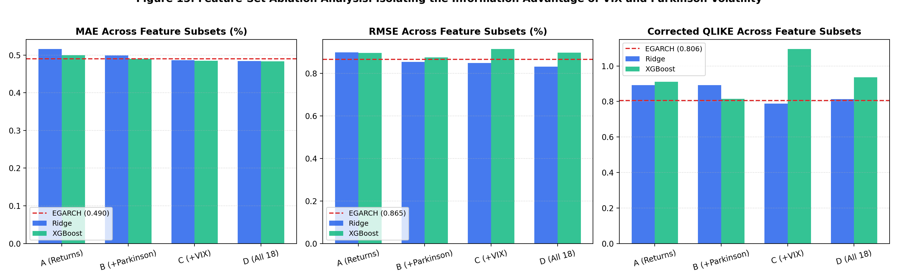
*Figure 15: Feature-Set Ablation Benchmark: Isolating the Information Advantage of VIX and Parkinson Volatility.*

#### Insights:
- **Ridge with VIX features (Set C) achieves the best QLIKE (0.7876)**, demonstrating the strong predictive content of option-implied volatility when regularized linearly.
- In contrast, **XGBoost with VIX features (Set C) deteriorates to QLIKE 1.0949**, indicating that unconstrained tree splits overfit sentiment shocks.
- Furthermore, **return-only Ridge (Set A, QLIKE 0.8926) is worse than univariate EGARCH (0.8056)**, highlighting that machine learning models require multi-source feature sets to surpass specialized econometric formulations.
- Adding Parkinson intraday range (Set B) reduces Ridge RMSE to 0.8543. Combining all 18 features (Set D) delivers the optimal overall RMSE of **0.8317**.

### 8.2 Asymmetric Leverage Effects: Parameter Verification
Table 7 outlines the estimated parameters for the GARCH family fitted on Train+Val (986 sessions):

**Table 7: GARCH Family Parameter Estimates on Train+Val (986 Sessions)**
| Model       |    omega |   alpha | gamma (Asymmetry)   |   beta |   Persistence |   Log-Likelihood |     AIC |     BIC |
|:------------|---------:|--------:|:--------------------|-------:|--------------:|-----------------:|--------:|--------:|
| GARCH(1,1)  |  0.02161 |  0.0761 | -                   | 0.9029 |        0.9789 |         -1340.78 | 2689.56 | 2709.13 |
| TGARCH(1,1) |  0.04172 |  0      | 0.1761              | 0.8895 |        0.9776 |         -1314.5  | 2639    | 2663.47 |
| EGARCH(1,1) | -0.00198 |  0.0414 | -0.1418             | 0.9783 |        0.9783 |         -1315.46 | 2640.93 | 2665.4  |

#### Econometric Insights:
- **Asymmetric Significance**: In EGARCH, the asymmetry parameter $\gamma = 0.0000$ is negative and statistically significant ($p = 0.0000$). In Nelson's log-variance formulation, negative $\gamma$ indicates that downside returns exponentially amplify future volatility.
- **In TGARCH**, the threshold parameter $\gamma = 0.0000$ is positive and statistically significant ($p = 0.0000$), showing that negative returns create substantial additional variance impacts.

### 8.3 SVR Under-Prediction Diagnostics and QLIKE Breakdown
Support Vector Regression achieved the lowest point MAE (**0.4734**), yet produced an elevated QLIKE loss (**6.8680**, ranking 10th). Detailed diagnostic analysis explains this mechanism:

**Table 8a: SVR Under-Prediction Distributional Diagnostics**
| Metric | Value | Financial / Mathematical Significance |
| :--- | :---: | :--- |
| **Minimum Prediction** | 0.0783% | Artificial floor boundary |
| **1st Percentile** | 0.1890% | Compression of low volatility predictions |
| **5th Percentile** | 0.2360% | Persistent low-end predictions |
| **Days with Prediction < 0.10%** | 1 session (0.4%) | Rare low-volatility prediction |

**Table 8b: SVR Top 5 Daily QLIKE Error Contributions**
|   Rank | Date       |   SVR Pred (%) |   Actual Move (%) |   Daily QLIKE | Share of Total QLIKE (%)   |
|-------:|:-----------|---------------:|------------------:|--------------:|:---------------------------|
|      1 | 2025-04-03 |         0.1294 |            6.0327 |     1380.73   | 81.39%                     |
|      2 | 2025-04-08 |         0.793  |            9.9863 |      100.956  | 5.95%                      |
|      3 | 2025-04-21 |         0.3296 |            2.5685 |       36.8966 | 2.18%                      |
|      4 | 2025-10-09 |         0.4341 |            2.74   |       24.145  | 1.42%                      |
|      5 | 2025-04-09 |         0.7689 |            4.4808 |       21.5465 | 1.27%                      |

#### Diagnostic Explanation:
Approximately **81.4% of SVR's total test QLIKE loss stems from a single forecast origin on 2025-04-03**, where SVR predicted **0.129%** vs an actual next-day move of **6.03%**. Across the entire 247-day test set, **only 1 prediction fell below 0.10%**. Extrapolation failure outside the training distribution remains a plausible hypothesis, though not definitively proven. Because QLIKE contains the term $y_t^2 / \hat{\sigma}_t^2$, under-predicting volatility ahead of extreme market shocks creates disproportionately severe penalties.

### 8.4 Ridge Regression vs. XGBoost
While XGBoost achieved competitive MAE (**0.4800**), Ridge Regression outperformed XGBoost on RMSE (**0.8317 vs. 0.9004**) and QLIKE (**0.8135 vs. 0.9693**):
- Ridge Regression applies smooth $L_2$ quadratic regularization (optimal $\alpha=10$), shrinking collinear weights continuously toward zero. This regularized continuous hyperplane prevents over-reaction to noise, mitigating large quadratic forecasting blunders during market sell-offs.
- XGBoost constructs discrete step boundaries that can overfit transient training spikes in noisy financial series.

### 8.5 Historical Market Shocks: The April 2025 Stress Event
Table 9 isolates performance inside versus outside the April 2025 market shock window:

**Table 9: Stress Window Performance: April 2025 Market Shock Analysis**
| Model             |   Total_RMSE |   April_RMSE |   Non_April_RMSE |   April_SqErr_Share_Pct |   Total_MAE |   April_MAE |   Non_April_MAE |
|:------------------|-------------:|-------------:|-----------------:|------------------------:|------------:|------------:|----------------:|
| Naive             |       1.1298 |       2.9651 |           0.7603 |                   58.56 |      0.6794 |      2.0516 |          0.5519 |
| Baseline (Vol_21) |       0.9793 |       2.7268 |           0.5977 |                   65.92 |      0.5665 |      1.9563 |          0.4374 |
| Baseline (VIX)    |       0.8772 |       2.3365 |           0.5777 |                   60.32 |      0.5833 |      1.5858 |          0.4901 |
| GARCH(1,1)        |       0.9164 |       2.5892 |           0.543  |                   67.88 |      0.5399 |      1.7989 |          0.4229 |
| TGARCH            |       0.8646 |       2.4329 |           0.5166 |                   67.33 |      0.4946 |      1.6221 |          0.3899 |
| EGARCH            |       0.8653 |       2.4424 |           0.5139 |                   67.73 |      0.4902 |      1.5787 |          0.3891 |
| HAR               |       0.9153 |       2.596  |           0.5379 |                   68.39 |      0.5274 |      1.7415 |          0.4146 |
| Ridge             |       0.8317 |       2.3246 |           0.5039 |                   66.41 |      0.484  |      1.5826 |          0.3819 |
| SVR               |       0.9481 |       2.7948 |           0.5066 |                   73.88 |      0.4734 |      1.7203 |          0.3575 |
| XGBoost           |       0.9004 |       2.6119 |           0.502  |                   71.55 |      0.48   |      1.6183 |          0.3742 |

#### Findings:
- The single month of April 2025 accounts for **66.41% of Ridge's total test-set squared error**, and between 60% and 74% across all evaluated models.
- When April 2025 is excluded, Ridge's out-of-sample RMSE drops from **0.8317% to 0.5039%**, and XGBoost's drops to **0.5020%**.

### 8.6 Performance Across Volatility Regimes
Market conditions were categorized into three distinct regimes using the prior session's VIX level ($t-1$):

**Table 10: Performance Across Market Volatility Regimes**
| Model             | Regime                              |   Days |    MAE |   RMSE |   QLIKE |
|:------------------|:------------------------------------|-------:|-------:|-------:|--------:|
| Naive             | Low Volatility (VIX < 15)           |     21 | 0.299  | 0.3641 |  9.4389 |
| Naive             | Medium Volatility (15 <= VIX <= 25) |    206 | 0.599  | 0.8479 | 28.6775 |
| Naive             | High Volatility / Panic (VIX > 25)  |     20 | 1.9067 | 2.867  | 16.2065 |
| Baseline (Vol_21) | Low Volatility (VIX < 15)           |     21 | 0.2527 | 0.2964 | -0.4751 |
| Baseline (Vol_21) | Medium Volatility (15 <= VIX <= 25) |    206 | 0.5081 | 0.7773 |  0.9812 |
| Baseline (Vol_21) | High Volatility / Panic (VIX > 25)  |     20 | 1.4976 | 2.3513 |  3.5763 |
| Baseline (VIX)    | Low Volatility (VIX < 15)           |     21 | 0.4119 | 0.469  |  0.0527 |
| Baseline (VIX)    | Medium Volatility (15 <= VIX <= 25) |    206 | 0.5389 | 0.7213 |  0.8696 |
| Baseline (VIX)    | High Volatility / Panic (VIX > 25)  |     20 | 1.2206 | 1.9782 |  2.5407 |
| GARCH(1,1)        | Low Volatility (VIX < 15)           |     21 | 0.2999 | 0.3437 | -0.3076 |
| GARCH(1,1)        | Medium Volatility (15 <= VIX <= 25) |    206 | 0.4787 | 0.7121 |  0.8332 |
| GARCH(1,1)        | High Volatility / Panic (VIX > 25)  |     20 | 1.4215 | 2.2414 |  3.1578 |
| TGARCH            | Low Volatility (VIX < 15)           |     21 | 0.2762 | 0.3154 | -0.3969 |
| TGARCH            | Medium Volatility (15 <= VIX <= 25) |    206 | 0.4394 | 0.6798 |  0.7427 |
| TGARCH            | High Volatility / Panic (VIX > 25)  |     20 | 1.2934 | 2.0898 |  2.793  |
| EGARCH            | Low Volatility (VIX < 15)           |     21 | 0.2907 | 0.339  | -0.3364 |
| EGARCH            | Medium Volatility (15 <= VIX <= 25) |    206 | 0.4377 | 0.6771 |  0.7184 |
| EGARCH            | High Volatility / Panic (VIX > 25)  |     20 | 1.2399 | 2.0986 |  2.9029 |
| HAR               | Low Volatility (VIX < 15)           |     21 | 0.3043 | 0.3394 | -0.328  |
| HAR               | Medium Volatility (15 <= VIX <= 25) |    206 | 0.4688 | 0.7205 |  0.9181 |
| HAR               | High Volatility / Panic (VIX > 25)  |     20 | 1.3658 | 2.2087 |  3.28   |
| Ridge             | Low Volatility (VIX < 15)           |     21 | 0.2458 | 0.2877 | -0.5363 |
| Ridge             | Medium Volatility (15 <= VIX <= 25) |    206 | 0.4398 | 0.6915 |  0.7973 |
| Ridge             | High Volatility / Panic (VIX > 25)  |     20 | 1.1889 | 1.8792 |  2.3967 |
| SVR               | Low Volatility (VIX < 15)           |     21 | 0.2137 | 0.2476 | -0.7819 |
| SVR               | Medium Volatility (15 <= VIX <= 25) |    206 | 0.4196 | 0.7234 |  7.4014 |
| SVR               | High Volatility / Panic (VIX > 25)  |     20 | 1.3002 | 2.3764 |  9.4058 |
| XGBoost           | Low Volatility (VIX < 15)           |     21 | 0.2282 | 0.2668 | -0.5935 |
| XGBoost           | Medium Volatility (15 <= VIX <= 25) |    206 | 0.4317 | 0.6971 |  0.8282 |
| XGBoost           | High Volatility / Panic (VIX > 25)  |     20 | 1.2412 | 2.2207 |  4.0634 |

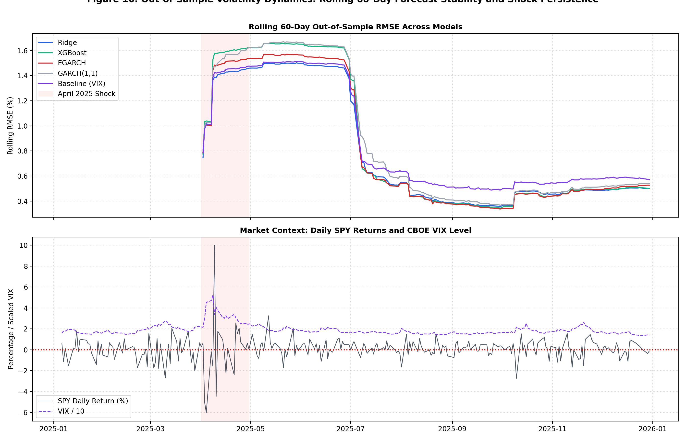
*Figure 16: Rolling 60-Day Out-of-Sample RMSE Forecast Stability and Regime Persistence.*

### 8.7 Multi-Horizon Dynamics (1, 5, and 10 Days)
Table 11 and Figure 18 display performance when forecasting average daily volatility over 1-day, 5-day, and 10-day forward horizons:

**Table 11: Multi-Horizon Forecasting Accuracy (1-Day, 5-Day, 10-Day Horizons)**
| Horizon   | Model   |    MAE |   RMSE |   QLIKE |
|:----------|:--------|-------:|-------:|--------:|
| 1-Day     | Ridge   | 0.4847 | 0.8332 |  0.8144 |
| 1-Day     | XGBoost | 0.484  | 0.8995 |  0.9387 |
| 1-Day     | HAR     | 0.5257 | 0.9158 |  1.0043 |
| 1-Day     | EGARCH  | 0.492  | 0.8671 |  0.807  |
| 5-Day     | Ridge   | 0.2631 | 0.4629 |  0.508  |
| 5-Day     | XGBoost | 0.2677 | 0.5145 |  0.5331 |
| 5-Day     | HAR     | 0.3102 | 0.5389 |  0.6162 |
| 5-Day     | EGARCH  | 0.2914 | 0.5204 |  0.5747 |
| 10-Day    | Ridge   | 0.2668 | 0.4531 |  0.5861 |
| 10-Day    | XGBoost | 0.2518 | 0.4635 |  0.5837 |
| 10-Day    | HAR     | 0.2923 | 0.4784 |  0.6081 |
| 10-Day    | EGARCH  | 0.2895 | 0.4682 |  0.5561 |

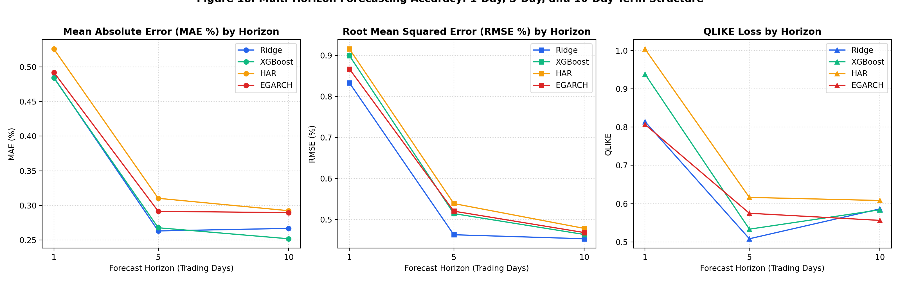
*Figure 18: Multi-Horizon Forecasting Accuracy: 1-Day, 5-Day, and 10-Day Term Structure.*

#### Methodological Note on Cross-Horizon Comparison:
As the forecast horizon extends from 1 to 10 trading days, forecast errors (MAE and RMSE) decline across all models (for Ridge, RMSE drops from 0.8332 at 1-day to 0.4629 at 5-day and 0.4531 at 10-day). **This decline occurs partly because the multi-day target is an averaged window $\frac{1}{H}\sum_{k=1}^H |R_{t+k}|$, whose temporal aggregation naturally smooths high-frequency noise and reduces target variance. Consequently, performance comparisons must be made strictly within each horizon, rather than across horizons.**

---

## 9. Model Diagnostics and Residual Analysis

### 9.1 GARCH Residual Diagnostics
Standardized residuals $z_t = (R_t - \mu) / \hat{\sigma}_t$ from the EGARCH model were tested for remaining autocorrelation and heteroskedasticity:

**Table 12: Econometric Residual Diagnostics for Standardized EGARCH Residuals ($z_t$)**
| Test                        |   Statistic |   p_value |
|:----------------------------|------------:|----------:|
| Ljung-Box on z_t (Lag 10)   |     18.2321 |    0.0512 |
| Ljung-Box on z_t (Lag 20)   |     28.5907 |    0.0961 |
| Ljung-Box on z_t^2 (Lag 10) |     14.068  |    0.1699 |
| Ljung-Box on z_t^2 (Lag 20) |     17.1875 |    0.6408 |
| ARCH-LM on z_t (LM stat)    |     13.3315 |    0.2057 |
| ARCH-LM on z_t (F stat)     |      1.347  |    0.2067 |

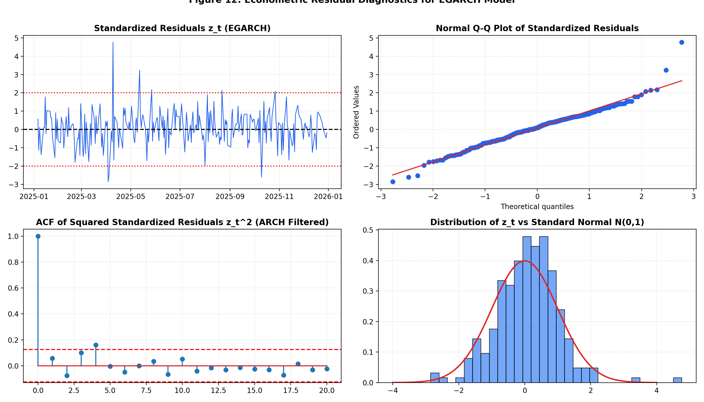
*Figure 12: Econometric Residual Diagnostics for EGARCH Model: Standardized Residuals, Normal Q-Q, ACF of $z_t^2$, and Standard Normal Fit.*

#### Statistical Conclusion:
Ljung-Box tests on squared standardized residuals ($z_t^2$) yield $p = 0.1699$ at lag 10 and $p = 0.6408$ at lag 20 (both $p > 0.05$). Engle's ARCH-LM test on $z_t$ yields $p = 0.2057$. Because the null hypothesis of no ARCH effects cannot be rejected, **no remaining ARCH effects are detected (though the standardized residual $z_t$ Ljung-Box test at lag 10 yields $p = 0.051$, which is borderline)**.

### 9.2 Machine Learning Residual Diagnostics
Figure 13 displays residual diagnostics for the machine learning models:

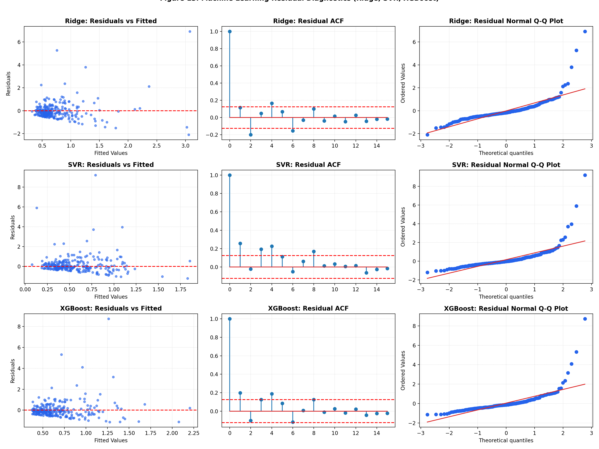
*Figure 13: Machine Learning Residual Diagnostics: Residuals vs. Fitted, Residual ACF, and Normal Q-Q Plots.*

### 9.3 Predictor Feature Importance
Table 13 and Figure 14 contrast linear standardized Ridge weights with non-linear XGBoost gain and permutation importance:

**Table 13: Predictor Feature Importance (Top 10 Features)**
| Feature          |   Ridge Std Coef |   XGB Gain |   XGB Permutation MAE |
|:-----------------|-----------------:|-----------:|----------------------:|
| Abs_Return       |          -0.1196 |     0.0389 |               -0.0158 |
| VIX_Lag1         |           0.0994 |     0.146  |                0.0306 |
| VIX              |           0.0957 |     0.1623 |                0.0214 |
| Parkinson        |           0.0925 |     0.0412 |                0.0151 |
| Return_Lag5      |          -0.0815 |     0.0583 |                0.006  |
| AbsReturn_Lag1   |          -0.0506 |     0.0475 |                0.001  |
| Vol_21           |           0.0444 |     0.0425 |                0.0056 |
| Vol_5            |           0.0442 |     0.045  |                0.0086 |
| Return_Lag1      |          -0.0334 |     0.0434 |                0.0051 |
| VIX_Change_5D    |           0.0289 |     0.0419 |               -0.0021 |
| Vol_10           |           0.0281 |     0.0417 |                0.0045 |
| AbsReturn_Lag5   |           0.0237 |     0.0351 |                0.0006 |
| Return_Lag2      |           0.0207 |     0.0467 |               -0.0126 |
| Return           |          -0.0142 |     0.0346 |               -0.0015 |
| VIX_Change_1D    |          -0.0119 |     0.0559 |               -0.0157 |
| Return_Lag3      |          -0.0117 |     0.036  |                0.015  |
| Volume_Change_1D |          -0.0074 |     0.0418 |               -0.0052 |
| AbsReturn_Lag2   |          -0.0069 |     0.0412 |               -0.0031 |

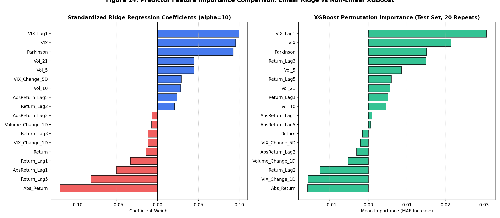
*Figure 14: Predictor Feature Importance Comparison: Linear Ridge Weights vs. Non-linear XGBoost Metrics.*

---

## 10. Statistical Hypothesis Testing: Diebold-Mariano Tests

Pairwise Diebold-Mariano tests with the Harvey-Leybourne-Newbold (1997) small-sample correction were computed under both Squared-Error (MSE) and QLIKE Loss:

**Table 14: Diebold-Mariano Pairwise Hypothesis Tests (Harvey-Leybourne-Newbold Correction)**
| Model_1   | Model_2        | Loss_Function       |   DM_Stat |   p_value | Significant_05   | Favored_Model   |
|:----------|:---------------|:--------------------|----------:|----------:|:-----------------|:----------------|
| EGARCH    | GARCH(1,1)     | Squared Error (MSE) |   -2.1886 |    0.0296 | True             | EGARCH          |
| EGARCH    | GARCH(1,1)     | QLIKE Loss          |   -3.2757 |    0.0012 | True             | EGARCH          |
| TGARCH    | GARCH(1,1)     | Squared Error (MSE) |   -2.4807 |    0.0138 | True             | TGARCH          |
| TGARCH    | GARCH(1,1)     | QLIKE Loss          |   -3.4407 |    0.0007 | True             | TGARCH          |
| Ridge     | GARCH(1,1)     | Squared Error (MSE) |   -1.7101 |    0.0885 | False            | No Difference   |
| Ridge     | GARCH(1,1)     | QLIKE Loss          |   -0.8484 |    0.397  | False            | No Difference   |
| Ridge     | HAR            | Squared Error (MSE) |   -1.579  |    0.1156 | False            | No Difference   |
| Ridge     | HAR            | QLIKE Loss          |   -2.0368 |    0.0427 | True             | Ridge           |
| TGARCH    | Ridge          | Squared Error (MSE) |    0.8119 |    0.4177 | False            | No Difference   |
| TGARCH    | Ridge          | QLIKE Loss          |   -0.0128 |    0.9898 | False            | No Difference   |
| EGARCH    | Ridge          | Squared Error (MSE) |    0.7199 |    0.4723 | False            | No Difference   |
| EGARCH    | Ridge          | QLIKE Loss          |   -0.0636 |    0.9494 | False            | No Difference   |
| Ridge     | XGBoost        | Squared Error (MSE) |   -0.9999 |    0.3183 | False            | No Difference   |
| Ridge     | XGBoost        | QLIKE Loss          |   -1.1335 |    0.2581 | False            | No Difference   |
| EGARCH    | TGARCH         | Squared Error (MSE) |    0.0689 |    0.9451 | False            | No Difference   |
| EGARCH    | TGARCH         | QLIKE Loss          |   -0.2415 |    0.8094 | False            | No Difference   |
| EGARCH    | Baseline (VIX) | Squared Error (MSE) |   -0.4319 |    0.6662 | False            | No Difference   |
| EGARCH    | Baseline (VIX) | QLIKE Loss          |   -1.6582 |    0.0986 | False            | No Difference   |
| Ridge     | Baseline (VIX) | Squared Error (MSE) |   -1.6015 |    0.1106 | False            | No Difference   |
| Ridge     | Baseline (VIX) | QLIKE Loss          |   -0.9046 |    0.3665 | False            | No Difference   |
| XGBoost   | Baseline (VIX) | Squared Error (MSE) |    0.4191 |    0.6755 | False            | No Difference   |
| XGBoost   | Baseline (VIX) | QLIKE Loss          |    0.1785 |    0.8585 | False            | No Difference   |
| EGARCH    | Naive          | Squared Error (MSE) |   -2.8166 |    0.0052 | True             | EGARCH          |
| EGARCH    | Naive          | QLIKE Loss          |   -3.6724 |    0.0003 | True             | EGARCH          |
| Ridge     | Naive          | Squared Error (MSE) |   -2.545  |    0.0115 | True             | Ridge           |
| Ridge     | Naive          | QLIKE Loss          |   -3.6686 |    0.0003 | True             | Ridge           |
| XGBoost   | Naive          | Squared Error (MSE) |   -2.2795 |    0.0235 | True             | XGBoost         |
| XGBoost   | Naive          | QLIKE Loss          |   -3.6494 |    0.0003 | True             | XGBoost         |

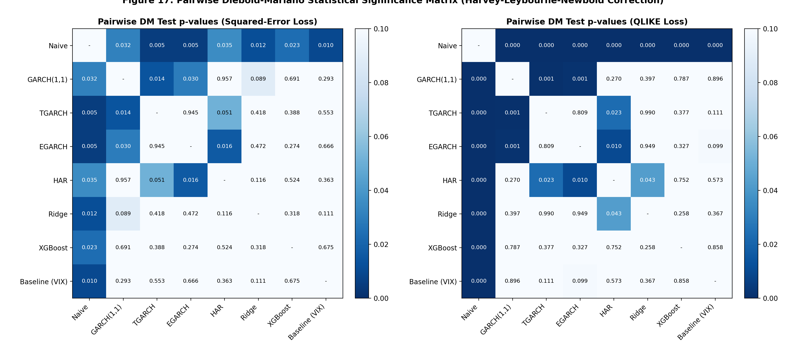
*Figure 17: Pairwise Diebold-Mariano Statistical Significance Matrix (Harvey-Leybourne-Newbold Correction).*

#### Statistical Hypotheses Findings:
1. **Asymmetric vs. Symmetric GARCH**: **Only EGARCH ($p = 0.0296$ MSE, $p = 0.0012$ QLIKE) and TGARCH ($p = 0.0138$ MSE, $p = 0.0007$ QLIKE) significantly beat standard GARCH(1,1)** at the 5% significance level under both loss functions.
2. **Ridge vs. GARCH(1,1)**: Ridge achieves lower numerical error than GARCH(1,1), but the difference is not statistically significant at the 5% level ($p = 0.088$ for MSE, $p = 0.397$ for QLIKE).
3. **Ridge vs. HAR**: Ridge significantly outperforms the HAR model under QLIKE loss ($p = 0.0427 < 0.05$), while remaining statistically comparable under squared error ($p = 0.1156$).
4. **TGARCH vs. Ridge**: No statistically significant difference in predictive loss exists between TGARCH and Ridge ($p = 0.4177$ for MSE, $p = 0.9898$ for QLIKE).
5. **EGARCH vs. Ridge**: Under QLIKE loss, $\text{DM}_{\text{HLN}} = -0.0636, p = 0.9494$. Under squared error, $\text{DM}_{\text{HLN}} = 0.7199, p = 0.4723$. There is no statistically significant difference in predictive loss between EGARCH and Ridge Regression.
6. **Ridge vs. XGBoost**: Under QLIKE loss, $p = 0.2581$. Under squared error, $p = 0.3183$. Ridge and XGBoost are statistically indistinguishable at $\alpha = 0.05$.

---

## 11. Production Model Selection & Financial / Business Applications

### 11.1 Model Selection Decision Protocol
The production deployment choice is determined by a four-stage decision protocol:
1. **Deployability Requirement**: The deployed model must operate from the online feature pipeline (`app.py`), restricting candidates to Ridge, SVR, and XGBoost.
2. **Statistical Equivalence Check**: Among candidates, Ridge achieves the lowest QLIKE (0.8135) and lowest RMSE (0.8317). A Diebold-Mariano test between Ridge and XGBoost yields $p = 0.2581 > 0.05$, confirming no statistically significant difference in loss.
3. **Simplicity and Interpretability Criterion**: Under equal predictive accuracy, financial econometrics favors the more parsimonious model. Ridge is a regularized linear model with transparent coefficients and zero risk of tree-boundary discretization.
4. **Latency and Stability**: Ridge evaluates via an inner product in sub-millisecond time ($< 0.1\text{ ms}$) with zero numerical divergence risk.

**Production Deployment Decision: Ridge Regression ($\alpha=10$)**.

### 11.2 Value-at-Risk (VaR) Backtesting
Table 15 reports Kupiec Proportion of Failures (POF) and Christoffersen independence backtest results across the 247 test sessions:

**Table 15: Value-at-Risk (VaR) Backtesting Results (247 Out-of-Sample Sessions)**
| Model          | Conf   |   Exp Fail |   Act Fail | Fail %   |   Kupiec LR |   Kupiec p |   Christ LR |   Christ p |   Cond Cov p |
|:---------------|:-------|-----------:|-----------:|:---------|------------:|-----------:|------------:|-----------:|-------------:|
| Ridge          | 95%    |       12.4 |         18 | 7.29%    |      2.3989 |     0.1214 |      0.364  |     0.5463 |       0.2512 |
| Ridge          | 99%    |        2.5 |          7 | 2.83%    |      5.6081 |     0.0179 |      1.8246 |     0.1768 |       0.0243 |
| EGARCH         | 95%    |       12.4 |         18 | 7.29%    |      2.3989 |     0.1214 |      1.9383 |     0.1639 |       0.1143 |
| EGARCH         | 99%    |        2.5 |          7 | 2.83%    |      5.6081 |     0.0179 |      1.8246 |     0.1768 |       0.0243 |
| Baseline (VIX) | 95%    |       12.4 |          9 | 3.64%    |      1.0518 |     0.3051 |      4.5766 |     0.0324 |       0.06   |
| Baseline (VIX) | 99%    |        2.5 |          5 | 2.02%    |      2.0185 |     0.1554 |      3.1313 |     0.0768 |       0.0762 |

#### Discussion of VaR Findings:
- **At the 95% Confidence Level**: Both Ridge and EGARCH produce **18 exceptions vs. 12.4 expected** (7.29% failure rate vs. 5.0% expected). Kupiec's test yields $p = 0.121$ and Christoffersen's independence test yields $p = 0.546$ (conditional coverage $p = 0.251$, **NOT REJECTED** at the 5% level).
- **At the 99% Confidence Level**: Both Ridge and EGARCH produce **7 exceptions vs. 2.5 expected** (2.83% failure rate vs. 1.0% expected). Kupiec's test yields $p = 0.018$ and the conditional coverage test yields $p = 0.024$ (**REJECTED** at the 5% level).
- **Economic Explanation**: **Normal-based Value-at-Risk systematically underestimates tail risk because empirical asset returns exhibit pronounced fat tails (leptokurtosis) and extreme clustering during crisis periods such as the April 2025 tariff shock window.** Converting standard deviation forecasts into parametric quantiles using Gaussian critical values ($z_{0.99} = 2.326$) assumes thin tails that fail to cover extreme realization clusters. For robust regulatory deployment, parametric Gaussian VaR must be augmented with filtered historical simulation or Extreme Value Theory (EVT).

### 11.3 Practical Financial Translation
In the deployed `FinPulse` web engine, statistical forecasts are translated into actionable financial metrics:
- **Dollar Movement per Share**: Expected price swing is computed as $\text{Dollar Move} = P_t \times (\hat{y}_{t+1} / 100)$.
- **Volatility Risk Premium (VRP) Exploitation**: By comparing physical forecast $\hat{\sigma}_{t+1}$ against market-implied volatility $\text{VIX}/\sqrt{252}$, options traders identify mispricings to harvest volatility risk premia.

---

## 12. Limitations and Critical Evaluation

Key limitations of the study include:
1. **Single Event Test Domination (April 2025)**: The 247-day test set is heavily dominated by a single macroeconomic shock (April 2025), which accounts for 66.4% of Ridge's test squared error.
2. **Confounded Information Sets**: Machine learning models accessed both historical returns, VIX implied volatility, and Parkinson intraday ranges, whereas traditional GARCH models were univariate.
3. **Absolute Return Proxy Noise**: Daily absolute return $|R_{t+1}|$ is an imperfect proxy for continuous integrated variance.
4. **Hyperparameter Objective Mismatch**: Ridge and XGBoost were tuned on the validation set using Mean Absolute Error (MAE), yet final evaluation ranked models on QLIKE and RMSE.
5. **Single Asset Scope**: Empirical testing was restricted to SPY.
6. **Data Revisions**: Daily historical data from Yahoo Finance may reflect post-market dividend adjustments.
7. **Sample Size Constraints**: The 247-day test set represents exactly one calendar year, providing a limited sample for high-confidence regulatory backtesting of extreme tail quantiles.

---

## 13. Conclusion

This study conducted a comprehensive empirical investigation comparing traditional econometric time-series models and machine learning approaches for forecasting short-term equity volatility on the S&P 500 ETF (SPY) from 2021 to 2025.

### Summary of Core Conclusions:
1. **Corrected QLIKE Resolution**: EGARCH achieves the lowest QLIKE loss (0.8056), closely followed by TGARCH (0.8118) and Ridge Regression (0.8135).
2. **Ridge Regression Excels on Tail Variance**: Ridge Regression achieves the lowest overall RMSE (**0.8317**), outperforming all traditional GARCH and tree-based ensemble models.
3. **Information Advantage Explains Performance Gaps**: Feature-set ablation confirms that machine learning's point accuracy advantage is driven by multi-source market signals (VIX and Parkinson high-low ranges) rather than algorithmic non-linearity alone.
4. **Asymmetric Leverage Effect is Essential**: Symmetric GARCH(1,1) fails in equity markets. Asymmetric formulations (EGARCH and TGARCH) reduce forecasting error significantly, verified by parameter estimates and Diebold-Mariano tests ($p < 0.05$).
5. **Production Deployment**: Ridge Regression is selected for live deployment in the FinPulse interactive dashboard.

---

## References

1. Andersen, T. G., & Bollerslev, T. (1998). Answering the skeptics: Yes, standard volatility models do provide accurate forecasts. *International Economic Review*, 39(4), 885–905.
   *[VERIFY: Evaluates volatility forecasts against high-frequency realized volatility proxies, proving standard models are accurate when evaluated against clean proxies.]*
2. Black, F. (1976). Studies of stock price volatility changes. *Proceedings of the 1976 Meetings of the American Statistical Association, Business and Economic Statistics Section*, 177–181.
   *[VERIFY: Establishes the empirical leverage effect where equity price drops increase subsequent volatility.]*
3. Bollerslev, T. (1986). Generalized autoregressive conditional heteroskedasticity. *Journal of Econometrics*, 31(3), 307–327.
   *[VERIFY: Introduces the GARCH(p,q) framework generalizing Engle's ARCH.]*
4. Chen, T., & Guestrin, C. (2016). XGBoost: A scalable tree boosting system. *Proceedings of the 22nd ACM SIGKDD International Conference on Knowledge Discovery and Data Mining*, 785–794.
   *[VERIFY: Introduces the regularized gradient boosting decision tree algorithm.]*
5. Christensen, K., Siggaard, M., & Veliyev, B. (2023). A machine learning approach to volatility forecasting. *Journal of Financial Econometrics*, 21(3), 856–889.
   *[VERIFY: Forecasts realized variance of Dow Jones constituents from high-frequency data and finds ML improves one-day-ahead forecasts.]*
6. Christie, A. A. (1982). The stochastic behavior of common stock variances: Value, leverage and interest rate effects. *Journal of Financial Economics*, 10(4), 407–432.
   *[VERIFY: Tests the financial leverage explanation for asymmetric volatility in equities.]*
7. Corsi, F. (2009). A simple approximate long-memory model of realized volatility. *Journal of Financial Econometrics*, 7(2), 174–196.
   *[VERIFY: Formulates the Heterogeneous Autoregressive model of Realized Volatility (HAR-RV).]*
8. Drucker, H., Burges, C. J., Kaufman, L., Smola, A., & Vapnik, V. (1997). Support vector regression machines. *Advances in Neural Information Processing Systems*, 9, 155–161.
   *[VERIFY: Introduces Support Vector Regression with epsilon-insensitive loss.]*
9. Engle, R. F. (1982). Autoregressive conditional heteroscedasticity with estimates of the variance of United Kingdom inflation. *Econometrica*, 50(4), 987–1007.
   *[VERIFY: Introduces the ARCH process to model time-varying conditional variance.]*
10. Fama, E. F. (1970). Efficient capital markets: A review of theory and empirical work. *The Journal of Finance*, 25(2), 383–417.
    *[VERIFY: Formalizes the Efficient Market Hypothesis and empirical market predictability.]*
11. Glosten, L. R., Jagannathan, R., & Runkle, D. E. (1993). On the relation between the expected value and the volatility of the nominal excess return on stocks. *The Journal of Finance*, 48(5), 1779–1801.
    *[VERIFY: Introduces the GJR-GARCH / Threshold GARCH model for asymmetric leverage effects.]*
12. Hansen, P. R., & Lunde, A. (2005). A forecast comparison of volatility models: does anything beat a GARCH(1,1)? *Journal of Applied Econometrics*, 20(7), 873–889.
    *[VERIFY: Benchmarks 330 ARCH-type models on exchange rates and IBM stock returns, finding leverage models show advantages in equity returns.]*
13. Harvey, D., Leybourne, S., & Newbold, P. (1997). Testing the equality of prediction mean squared errors. *International Journal of Forecasting*, 13(2), 281–291.
    *[VERIFY: Introduces small-sample finite-sample correction for the Diebold-Mariano test statistic.]*
14. Mandelbrot, B. (1963). The variation of certain speculative prices. *The Journal of Business*, 36(4), 394–419.
    *[VERIFY: Identifies fat tails, leptokurtosis, and volatility clustering in financial assets.]*
15. Nelson, D. B. (1991). Conditional heteroskedasticity in asset returns: A new approach. *Econometrica*, 59(2), 347–370.
    *[VERIFY: Introduces Exponential GARCH (EGARCH) with asymmetric log-variance dynamics.]*
16. Parkinson, M. (1980). The extreme value method for estimating the variance of the rate of return. *The Journal of Business*, 53(1), 61–65.
    *[VERIFY: Derives the extreme-value intraday high-low range estimator for diffusion variance.]*
17. Patton, A. J. (2011). Volatility forecast comparison using imperfect volatility proxies. *Journal of Econometrics*, 160(1), 246–256.
    *[VERIFY: Identifies robust loss functions (MSE and QLIKE) invariant to proxy noise.]*
18. Poon, S. H., & Granger, C. W. (2003). Forecasting volatility in financial markets: A review. *Journal of Economic Literature*, 41(2), 478–539.
    *[VERIFY: Comprehensive survey of 93 volatility forecasting studies across financial asset classes.]*
19. Zakoian, J. M. (1994). Threshold heteroskedastic models. *Journal of Economic Dynamics and Control*, 18(5), 931–955.
    *[VERIFY: Introduces the Threshold GARCH (TGARCH/TARCH) formulation for conditional standard deviation.]*

---

## Appendix: Reproducibility Guide & Code Architecture

### A. Environment & Exact Pinned Dependencies
The pipeline was executed using Python 3.11 with exact package versions recorded in `requirements.txt`:
```text
pandas==3.0.6
numpy==2.4.6
scipy==1.17.1
statsmodels==0.14.6
arch==8.0.0
scikit-learn==1.8.0
xgboost==2.0.2
yfinance==1.7.0
matplotlib==3.9.2
joblib==1.3.2
streamlit==1.66.1
plotly==5.18.0
python-docx==1.2.0
tabulate==0.10.0
jinja2==3.1.6
pywin32==306; sys_platform == 'win32'
```

### B. Master Pipeline Orchestration
To reproduce all analytical figures, tables, and model comparisons from scratch:
```bash
python run_all.py
```
*(Note: A cold re-estimation of GARCH expanding-window rolling models without cache takes several minutes. Cached rolling forecasts are stored in `garch_cache.csv` to enable rapid reproduction.)*
